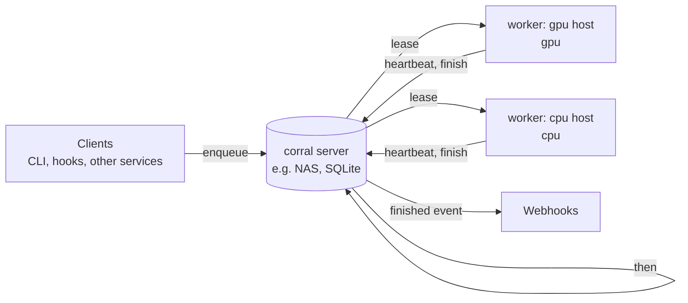

# corral

Priority job scheduler for opportunistic local compute.

Pipelines on clocks (one step at :00, the next at :30) make work that arrives at :01 wait most of an hour at each step.
Corral replaces the clocks with a resource-aware queue. A step enqueues the next one when it finishes, so work flows
through as soon as a machine with what it needs is free, and a machine someone wants for themselves can be paused
without losing anything.

## What it does

- **Priorities with aging.** Urgent work goes first, and waiting work gains priority until it runs.
- **Pause that stays paused.** `corral pause gpu-host` lets the running job finish, takes nothing new, and holds
  until `corral resume` or for as long as you said (`--for 2h`), across restarts.
- **Chained work.** A job can name the jobs to enqueue when it succeeds, and the server posts a finished event to
  any webhook that wants it.
- **Sized to a window.** A job is told how many items it can likely finish in its kind's time window, based on how
  fast that kind has run before. The job may ignore it.
- **Workers pull.** Each worker advertises capability labels and leases jobs it can run, so adding a machine is
  starting a worker.

> **In development:** this repository holds the specification. There is no runnable release yet.

See the [specification](docs/SPEC.md) and [stack and decisions](docs/stack.md).

Apache-2.0. See [LICENSE](LICENSE) and [NOTICE](NOTICE).
